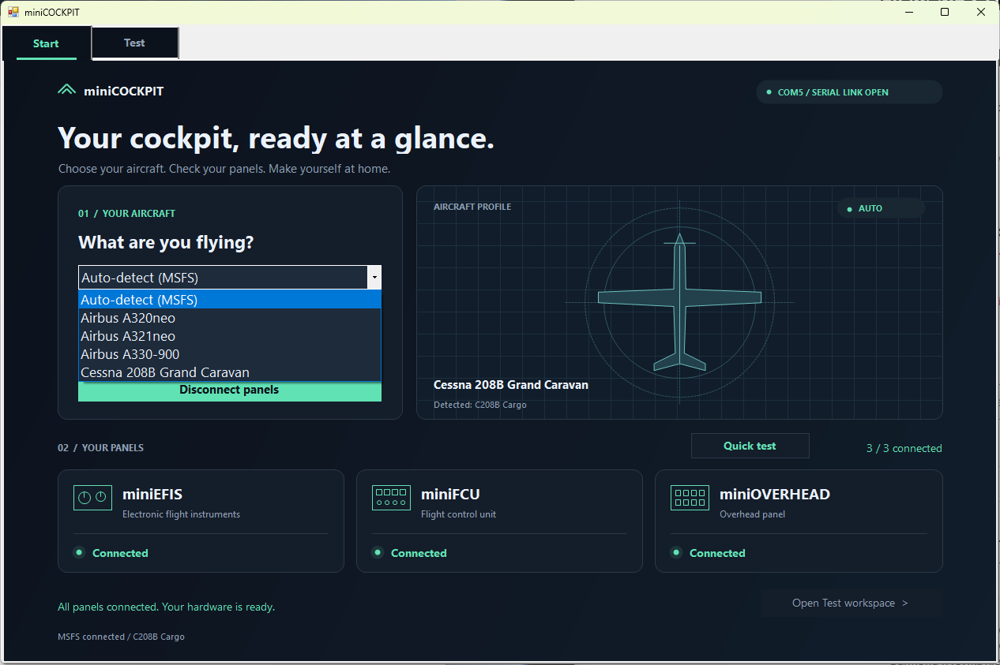
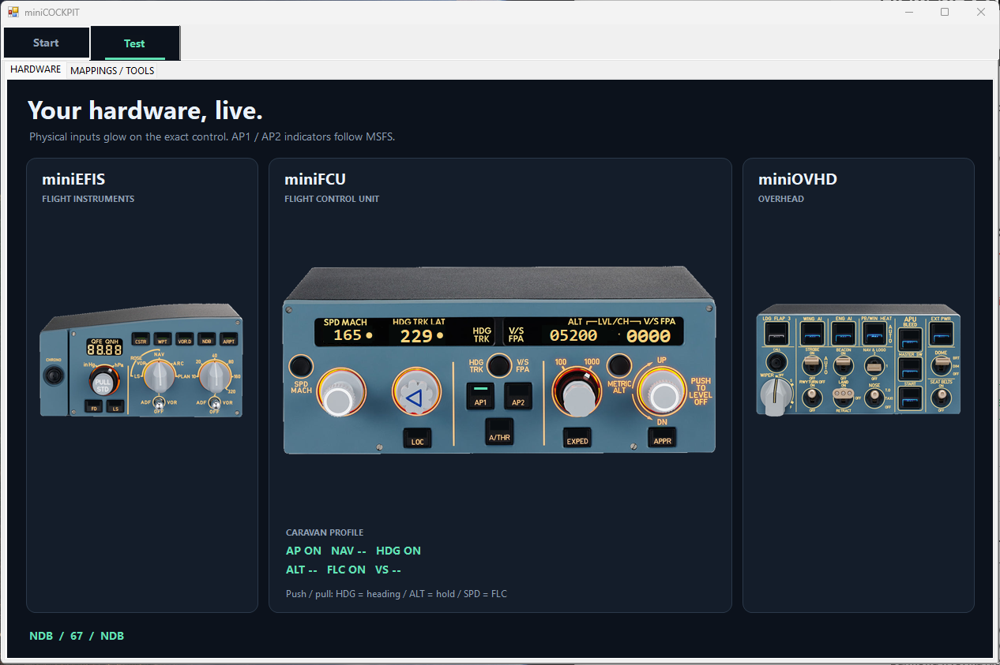

# miniCOCKPIT

A small Windows app for miniFCU, miniEFIS and miniOVHD. See what the hardware sends, map controls, test lights, and fly the C208 in MSFS.

**Start:** automatic aircraft detection, manual selection, panel connection status, and a three-second test of all 29 button lights.



**Test:** real panel photos highlight the control you touch. Mappings, raw serial traffic, captures and output tests live here too.



## Hardware protocol

Plain ASCII over USB serial: **9600 baud, 8N1**, no flow control, DTR/RTS off. Close miniCOCKPIT DLS first; only one app can own the port.

```text
Hardware -> app:  50;          AP1 pressed
Hardware -> app:  17,12300;    ALT clockwise, current hardware value 12300
App -> hardware:  A12300,      display selected altitude
App -> hardware:  H234,        display heading 234
App -> hardware:  P, / p,      AP1 light on / off
```

Incoming frames end with `;`: either `code` or `code,value`. Buffer partial reads; a serial read is not necessarily a whole frame. Outgoing commands are case-sensitive; the examples above end with `,`.

Startup sends `C;`, `C`, `C`, then `{1,`, `@1,`, `#1013,` to initialize EFIS in numeric QNH at 1013 hPa. That pressure is a startup default, not a simulator readback.

Connection reports: `901` = FCU/controller, `956`/`957` = EFIS connected/disconnected, `958`/`959` = overhead connected/disconnected. Silence does not mean disconnected.

Input labels live in `src\mappings.json`; output labels in `src\light-mappings.json`. More protocol notes: [minicockpit.md](minicockpit.md).

## MSFS integration

An independent **x64 SimConnect** client polls every **250 ms**. `TITLE` identifies the aircraft; a manual choice overrides detection. **Only the C208/Caravan has simulator controls implemented.**

The app sends **key events**, not direct SimVar writes:

| Hardware input | MSFS event / behavior |
|---|---|
| AP1 (`50`) | `AP_MASTER`: toggle autopilot |
| AP2 (`51`) | `AP_NAV1_HOLD`: toggle NAV |
| HDG push or pull (`1`/`2`) | `AP_PANEL_HEADING_ON`: enable heading mode |
| ALT push or pull (`15`/`16`) | `AP_ALT_HOLD_ON`: enable altitude hold |
| SPD push or pull (`11`/`12`) | `FLIGHT_LEVEL_CHANGE_ON`: enable FLC |
| HDG rotation (`3`/`4`) | `HEADING_BUG_SET`, or `HEADING_BUG_INC` / `HEADING_BUG_DEC` |
| ALT rotation (`17`/`18`) | `AP_ALT_VAR_INC` / `AP_ALT_VAR_DEC`: 100-foot steps; 1000 when the hardware value differs from the simulator target by exactly 1000 |
| SPD rotation (`13`/`14`) | `AP_SPD_VAR_SET`, or `AP_SPD_VAR_INC` / `AP_SPD_VAR_DEC`; only while FLC is active |
| V/S rotation (`21`/`22`) | `AP_VS_VAR_SET_ENGLISH`, or `AP_VS_VAR_INC` / `AP_VS_VAR_DEC`; changes the target, not the mode |
| STROBE | `STROBES_SET`: OFF = 0, ON = 1; AUTO follows `!SIM ON GROUND` |
| BEACON | `BEACON_LIGHTS_SET`: OFF = 0, ON = 1 |
| NAV & LOGO | `NAV_LIGHTS_SET`: OFF = 0, positions 1/2 = 1 |
| LAND | `LANDING_LIGHTS_SET`: ON = 1, OFF/RETRACT = 0 |
| NOSE / RWY TURN OFF | `TAXI_LIGHTS_SET`: on while either switch's last observed position requests it |

HDG, SPD and V/S use SET when the frame includes a numeric value, otherwise INC/DEC. ALT deliberately uses steps: the Caravan's NXi turns absolute altitude SET events into knob movements.

Simulator readbacks drive the LEDs and displays: `AUTOPILOT MASTER`, `AUTOPILOT NAV1 LOCK`, HDG/ALT/FLC/V/S modes and their selected targets. SPD shows the selected speed in FLC, otherwise dashes. Green activity rectangles expire after two seconds; they are not mode indicators.

Controls require fresh Caravan telemetry (under three seconds old), the Caravan profile and initialized hardware. Mapping tools and light tests pause simulator control. Connecting alone sends no flight-control events.

**Build and run:** Windows, .NET Framework, and the x64 SDK files `Microsoft.FlightSimulator.SimConnect.dll` and `SimConnect.dll`.

```powershell
.\src\build.ps1 -SimConnectDirectory 'C:\path\to\x64\SimConnect'
.\src\MiniCockpitLab.exe --connect
```
